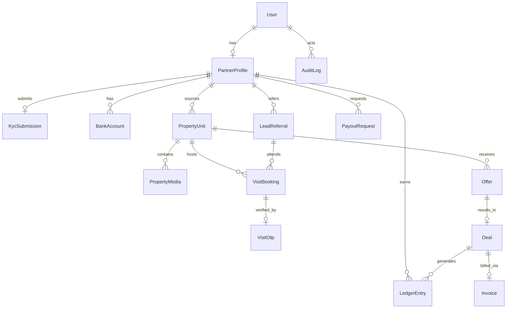

# Proho Platform — Database Schema Specification

This document details the relational database schema implemented in PostgreSQL. All entities use `UUID` primary keys unless noted. Financial amounts use `NUMERIC(12, 2)`.

---

## 1. Entity Relationship Diagram (High-Level Overview)

---

## 2. Core Tables & Fields

### `accounts_user`
Custom User model inheriting from `AbstractBaseUser` and `PermissionsMixin`.
- `id`: `UUID` (PK, default `uuid_generate_v4()`)
- `phone`: `VARCHAR(15)` (Unique, indexed, E.164 format)
- `email`: `VARCHAR(255)` (Nullable, Unique)
- `full_name`: `VARCHAR(255)`
- `role`: `VARCHAR(30)` (`PARTNER`, `ADMIN`, `SUPERADMIN`)
- `preferred_language`: `VARCHAR(10)` (`en`, `hi`, default `en`)
- `is_active`: `BOOLEAN` (default `True`)
- `is_staff`: `BOOLEAN` (default `False`)
- `created_at`: `TIMESTAMPTZ` (UTC)
- `updated_at`: `TIMESTAMPTZ` (UTC)

### `partners_profile`
Partner business metadata and geographical operating markets.
- `id`: `UUID` (PK)
- `user_id`: `UUID` (FK -> `accounts_user`, Unique, On Delete Cascade)
- `agency_name`: `VARCHAR(255)` (Nullable)
- `base_location`: `VARCHAR(100)` (Indexed, e.g. "Central Noida", "Greater Noida West")
- `work_areas`: `JSONB` (Array of area slugs/names)
- `rera_number`: `VARCHAR(50)` (Nullable)
- `kyc_status`: `VARCHAR(30)` (`NOT_SUBMITTED`, `PENDING`, `APPROVED`, `REJECTED`, default `NOT_SUBMITTED`)
- `total_earned`: `NUMERIC(12, 2)` (Default 0.00)
- `current_balance`: `NUMERIC(12, 2)` (Default 0.00)
- `created_at`: `TIMESTAMPTZ`

### `partners_kyc_submission`
Documents submitted for verification.
- `id`: `UUID` (PK)
- `partner_id`: `UUID` (FK -> `partners_profile`, On Delete Cascade)
- `pan_number`: `VARCHAR(10)` (Encrypted / Validated)
- `pan_document_url`: `VARCHAR(1000)` (Private S3 URL)
- `aadhaar_last_four`: `VARCHAR(4)`
- `address_document_url`: `VARCHAR(1000)`
- `rera_document_url`: `VARCHAR(1000)` (Nullable)
- `status`: `VARCHAR(30)` (`PENDING`, `APPROVED`, `REJECTED`)
- `reviewed_by_id`: `UUID` (FK -> `accounts_user`, Nullable)
- `rejection_reason`: `TEXT` (Nullable)
- `reviewed_at`: `TIMESTAMPTZ` (Nullable)
- `created_at`: `TIMESTAMPTZ`

### `partners_bank_account`
Bank accounts for payout disbursement.
- `id`: `UUID` (PK)
- `partner_id`: `UUID` (FK -> `partners_profile`)
- `account_holder_name`: `VARCHAR(255)`
- `account_number`: `VARCHAR(50)`
- `ifsc_code`: `VARCHAR(11)`
- `bank_name`: `VARCHAR(100)`
- `proof_document_url`: `VARCHAR(1000)`
- `is_verified`: `BOOLEAN` (Default `False`)
- `is_primary`: `BOOLEAN` (Default `True`)
- `created_at`: `TIMESTAMPTZ`

### `properties_unit`
Inventory records (both sourced partner units and Proho verified pool).
- `id`: `UUID` (PK)
- `category`: `VARCHAR(30)` (`SOURCED_UNIT`, `PROHO_VERIFIED_POOL`)
- `sourced_by_id`: `UUID` (FK -> `partners_profile`, Nullable)
- `society_name`: `VARCHAR(255)` (Indexed)
- `tower`: `VARCHAR(50)`
- `unit_number`: `VARCHAR(50)`
- `bhk_type`: `VARCHAR(20)` (`1BHK`, `2BHK`, `3BHK`, `4BHK`, `STUDIO`, `OTHER`)
- `super_area_sqft`: `NUMERIC(10, 2)`
- `carpet_area_sqft`: `NUMERIC(10, 2)`
- `floor_number`: `INTEGER`
- `total_floors`: `INTEGER`
- `tenancy_status`: `VARCHAR(30)` (`VACANT`, `TENANTED`, `SELF_OCCUPIED`)
- `asking_price`: `NUMERIC(14, 2)` (INR)
- `rate_per_sqft`: `NUMERIC(12, 2)`
- `status`: `VARCHAR(30)` (`SUBMITTED`, `EVALUATING`, `AVAILABLE`, `UNDER_OFFER`, `SOLD`, `REJECTED`)
- `commission_rate`: `NUMERIC(5, 2)` (e.g. 2.00 for 2%)
- `smart_lock_id`: `VARCHAR(100)` (Nullable)
- `created_at`: `TIMESTAMPTZ`
- *Unique Constraint*: `(society_name, tower, unit_number)`

### `properties_media`
Image and video assets for property units.
- `id`: `UUID` (PK)
- `unit_id`: `UUID` (FK -> `properties_unit`, On Delete Cascade)
- `media_type`: `VARCHAR(20)` (`IMAGE`, `FLOOR_PLAN`, `VIDEO`)
- `asset_url`: `VARCHAR(1000)`
- `is_featured`: `BOOLEAN` (Default `False`)
- `display_order`: `INTEGER` (Default `0`)
- `created_at`: `TIMESTAMPTZ`

### `leads_lead`
Buyer leads submitted and owned by channel partners.
- `id`: `UUID` (PK)
- `partner_id`: `UUID` (FK -> `partners_profile`, Indexed)
- `customer_name`: `VARCHAR(255)`
- `customer_phone`: `VARCHAR(15)` (Indexed)
- `customer_email`: `VARCHAR(255)` (Nullable)
- `property_id`: `UUID` (FK -> `properties_unit`, Nullable)
- `budget_min`: `NUMERIC(14, 2)` (Nullable)
- `budget_max`: `NUMERIC(14, 2)` (Nullable)
- `preferred_bhk`: `VARCHAR(20)` (Nullable)
- `preferred_location`: `VARCHAR(100)` (Nullable)
- `source`: `VARCHAR(50)` (Default: `DIRECT_INPUT`)
- `status`: `VARCHAR(30)` (`NEW`, `CONTACTED`, `VISITING`, `OFFER_MADE`, `CLOSED`, `LOST`, `EXPIRED`)
- `attribution_expires_at`: `TIMESTAMPTZ` (Now + 60 days)
- `last_interaction_at`: `TIMESTAMPTZ`
- `notes`: `TEXT`
- `created_at`: `TIMESTAMPTZ`
- `updated_at`: `TIMESTAMPTZ`

### `leads_referral_token`
Opaque URL sharing tokens for partner-attributed inventory marketing.
- `id`: `UUID` (PK)
- `token`: `VARCHAR(64)` (Unique, Indexed, 32-character base64url)
- `partner_id`: `UUID` (FK -> `partners_profile`)
- `property_id`: `UUID` (FK -> `properties_unit`)
- `is_active`: `BOOLEAN` (Default `True`)
- `clicks_count`: `INTEGER` (Default 0)
- `expires_at`: `TIMESTAMPTZ` (Nullable)
- `created_at`: `TIMESTAMPTZ`

### `offers_offer`
Property purchase/lease offers and counteroffer negotiation chains.
- `id`: `UUID` (PK)
- `property_id`: `UUID` (FK -> `properties_unit`, Indexed)
- `lead_id`: `UUID` (FK -> `leads_lead`, Nullable, Indexed)
- `partner_id`: `UUID` (FK -> `partners_profile`, Indexed)
- `created_by_id`: `UUID` (FK -> `accounts_user`)
- `offer_amount`: `NUMERIC(14, 2)` (INR)
- `status`: `VARCHAR(30)` (`DRAFT`, `SUBMITTED`, `UNDER_REVIEW`, `COUNTERED`, `ACCEPTED`, `REJECTED`, `EXPIRED`)
- `counter_to_id`: `UUID` (Self-referential FK -> `offers_offer`, Nullable)
- `expires_at`: `TIMESTAMPTZ` (Nullable, default 72h)
- `notes`: `TEXT`
- `rejection_reason`: `TEXT`
- `created_at`: `TIMESTAMPTZ`
- `updated_at`: `TIMESTAMPTZ`

### `visits_booking`
Property booking requests.
- `id`: `UUID` (PK)
- `property_id`: `UUID` (FK -> `properties_unit`, Indexed)
- `lead_id`: `UUID` (FK -> `leads_lead`, Nullable)
- `partner_id`: `UUID` (FK -> `partners_profile`, Indexed)
- `status`: `VARCHAR(30)` (`REQUESTED`, `CONFIRMED`, `CANCELLED`, `COMPLETED`)
- `booked_at`: `TIMESTAMPTZ`
- `cancelled_at`: `TIMESTAMPTZ` (Nullable)
- `cancellation_reason`: `TEXT`
- `notes`: `TEXT`
- `created_at`: `TIMESTAMPTZ`
- `updated_at`: `TIMESTAMPTZ`

### `visits_visit`
Scheduled property site visits with slot lockout and representative assignment.
- `id`: `UUID` (PK)
- `booking_id`: `UUID` (FK -> `visits_booking`, Nullable)
- `property_id`: `UUID` (FK -> `properties_unit`, Indexed)
- `lead_id`: `UUID` (FK -> `leads_lead`, Nullable)
- `partner_id`: `UUID` (FK -> `partners_profile`, Indexed)
- `assigned_representative_id`: `UUID` (FK -> `accounts_user`, Nullable)
- `scheduled_start`: `TIMESTAMPTZ` (Indexed)
- `scheduled_end`: `TIMESTAMPTZ`
- `status`: `VARCHAR(30)` (`SCHEDULED`, `VERIFIED_COMPLETED`, `CANCELLED`, `NO_SHOW`, `FAILED_VERIFICATION`)
- `cancellation_reason`: `VARCHAR(255)`
- `cancelled_at`: `TIMESTAMPTZ` (Nullable)
- `created_at`: `TIMESTAMPTZ`
- `updated_at`: `TIMESTAMPTZ`

### `visits_otp`
Cryptographic salted PBKDF2 verification tokens for door access.
- `id`: `UUID` (PK)
- `visit_id`: `UUID` (FK -> `visits_visit`, Unique)
- `otp_hash`: `VARCHAR(255)` (PBKDF2 salted hash of 6-digit OTP)
- `expires_at`: `TIMESTAMPTZ` (Scheduled time + 300s window)
- `attempt_count`: `INTEGER` (Default 0, max 3)
- `is_consumed`: `BOOLEAN` (Default `False`)
- `consumed_at`: `TIMESTAMPTZ` (Nullable)
- `created_at`: `TIMESTAMPTZ`

### `finance_ledger_entry`
Double-entry immutable earnings record.
- `id`: `UUID` (PK)
- `partner_id`: `UUID` (FK -> `partners_profile`, Indexed)
- `entry_type`: `VARCHAR(20)` (`CREDIT`, `DEBIT`)
- `amount`: `NUMERIC(12, 2)`
- `currency`: `VARCHAR(3)` (Default `INR`)
- `category`: `VARCHAR(50)` (`COMMISSION_DEAL`, `BONUS_INCENTIVE`, `PAYOUT_DISBURSEMENT`, `TAX_DEDUCTION`, `REVERSAL`)
- `reference_id`: `VARCHAR(100)` (Deal ID, Payout ID, or Invoice ID)
- `running_balance`: `NUMERIC(12, 2)`
- `description`: `TEXT`
- `created_at`: `TIMESTAMPTZ`

### `finance_payout_request`
Partner withdrawal requests.
- `id`: `UUID` (PK)
- `partner_id`: `UUID` (FK -> `partners_profile`, Indexed)
- `bank_account_id`: `UUID` (FK -> `partners_bank_account`)
- `amount`: `NUMERIC(12, 2)`
- `status`: `VARCHAR(30)` (`REQUESTED`, `APPROVED`, `PAID`, `REJECTED`)
- `utr_reference`: `VARCHAR(100)` (Nullable, Mandatory when PAID)
- `processed_by_id`: `UUID` (FK -> `accounts_user`, Nullable)
- `payment_date`: `TIMESTAMPTZ` (Nullable)
- `rejection_reason`: `TEXT` (Nullable)
- `created_at`: `TIMESTAMPTZ`

### `audit_log`
System-wide audit trail.
- `id`: `UUID` (PK)
- `actor_id`: `UUID` (FK -> `accounts_user`, Nullable)
- `action`: `VARCHAR(100)` (e.g. `KYC_APPROVE`, `PAYOUT_MARK_PAID`, `OFFER_COUNTER`)
- `target_model`: `VARCHAR(100)`
- `target_id`: `UUID`
- `ip_address`: `INET` (Nullable)
- `payload`: `JSONB` (State before and after)
- `created_at`: `TIMESTAMPTZ` (UTC)
